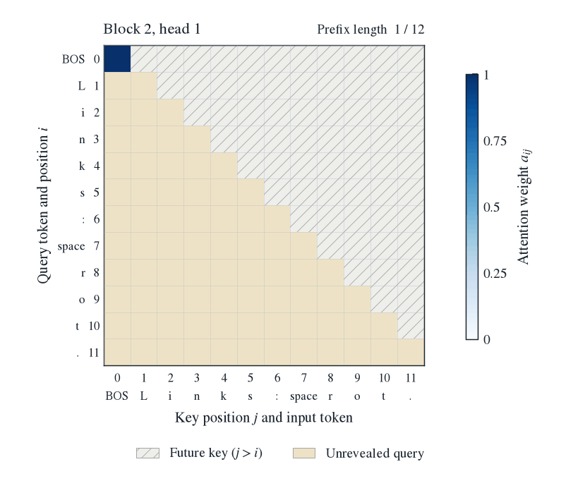
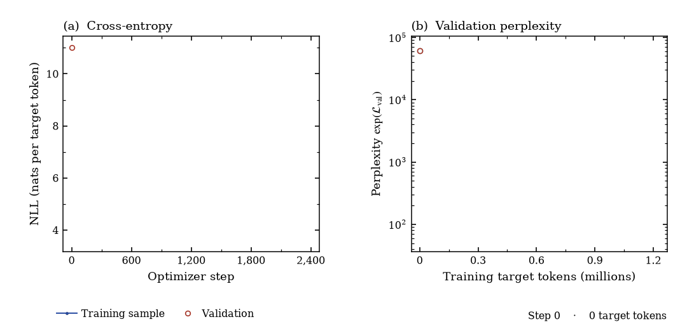
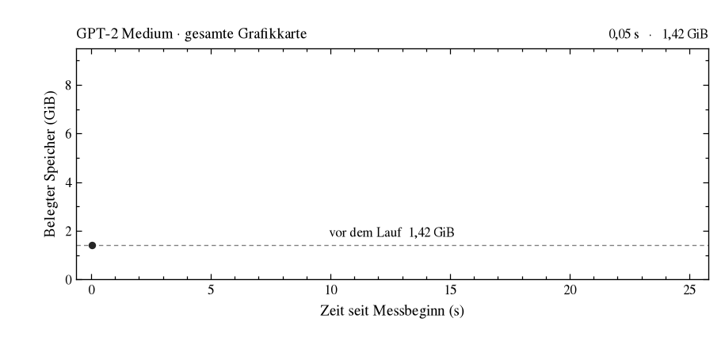

# nabla-flow

`Fach A: Glas. Fach B: Harz. In B liegt ` – mein Sprachmodell ergänzt **`Glas.`**. Der Satz liest sich tadellos. Man muss nur noch einmal auf Fach B schauen.

An diesem Fehler lässt sich eine Frage untersuchen, die bei einer Kostprobe aus einem großen Sprachmodell schwer zu beantworten ist. **Woran erkenne ich, ob das Modell die Zuordnung gelernt hat?** Hier kann ich beide Fächer abfragen, die Startgewichte festhalten und genau einen Term in der Rechnung ändern. Der Decoder ist in C geschrieben. Seine kleinste trainierte Variante hat 35.776 Parameter und läuft auf einer CPU. Derselbe Aufbau reicht bis zu GPT-2 Medium auf einer einzelnen RTX 4070 SUPER. [Lernskript mit sieben Kapiteln](docs/lernskript/README.md) · [Versuche zum Weitererzählen](docs/werkstattnotiz.md) · [English build and training guide](docs/training-124m.md)

## Zwei Fragen an dieselben Gewichte

Lass die Belegung auf dem Tisch liegen und ändere nur den letzten Buchstaben der Fachbezeichnung in der Frage. Wer immer das zuerst genannte Material kopiert, beantwortet genau die Hälfte der Fragen richtig. Wie oft hat diese Strategie bei derselben Belegung **beide** Antworten richtig? Kein einziges Mal. Damit haben wir einen Test, bei dem eine vertraut klingende Antwort wenig hilft.

Für den Gegenversuch startet das Training zweimal mit denselben 35.776 Zahlen und denselben Batches. Im zweiten Lauf zählt jedes Byte des **letzten Antwortworts** vierfach zum Verlust. Nach genau 1.800 Updates steigt die Zahl der vollständig gelösten Belegungen auf der Validierung von **4 auf 10 von 28**. Auf dem getrennten Testsatz fällt sie von **7 auf 6 von 28**. Ein Blick in die Einzelantworten erklärt, was der Mittelwert verbirgt. Bei Farben gewinnt das Modell Doppeltreffer hinzu, bei den Materialfächern verliert es alle vier Doppeltreffer aus dem Kontrolllauf auf dem Test. Beide Läufe verwenden Seed 42. Wie stabil die Verschiebung über andere Startgewichte ist, bleibt offen. [Vergleich und Auswertung der einzelnen Belegungen](docs/lernskript/05-antwortgewicht.md) · [Messdaten](results/answer-weight/comparison.csv)

[](results/answer-weight/paired-recall.pdf)

## Was darf ein Buchstabe schon wissen?

Lies `Links: rot.` bis zum Doppelpunkt. Welche Buchstaben stehen dir bis dahin für eine Vorhersage zur Verfügung? Die Animation zeigt, wie ein trainierter Attention-Kopf diese Rechnung bei jedem weiteren Byte wiederholt. Such die Zeile für den Doppelpunkt und folge ihr nach rechts. Die Schraffur beginnt beim nächsten Zeichen. Innerhalb des erlaubten Bereichs addieren sich die Gewichte jeder Zeile zu eins.

[](figures/attention.svg)

Der schraffierte Bereich folgt aus der Schleifengrenze im C-Code. Die Helligkeiten links davon hängen von Text und Modellgewichten ab. Ein unabhängiger Test ersetzt den Schluss der Eingabe und vergleicht die früheren Vorhersagen Bit für Bit. Die beiden Experimente lassen sich mit dem mitgelieferten Byte-Modell wiederholen. [Rechnung für eine Zeile](docs/lernskript/02-transformer.md) · [Einzelwerte](results/attention.csv) · [Druckfassung](figures/attention.pdf) · [Byte-Modelle selbst ausprobieren](docs/byte-models.md)

## Was passiert, wenn man Romeo zwei Minuten lang trainiert?

GPT-2 Small startet hier mit 124.439.808 zufällig initialisierten Parametern. Vor dem ersten Update folgt auf `ROMEO:` und einen Zeilenumbruch die Fortsetzung ` Arsenal stained slap`. Nach 2.400 Updates auf *Tiny Shakespeare* kommt bei gleichem Prompt und Sampling-Seed diese Zeile heraus:

```text
ROMEO:
Now, that is the time of me to hear.
```

Ist der Satz abgeschrieben? Die längste exakte Übereinstimmung mit einer einzelnen Trainingsrede umfasst drei aufeinanderfolgende GPT-2-Tokens, `, that is`. Die Wendung klingt nach einer Rede, bis man versucht, *the time of me to hear* zu übersetzen. Neben der Wortprobe habe ich deshalb den Vorhersagefehler auf vollständigen zurückgehaltenen Reden gemessen. [Alle 25 Textproben und Fundstellen](results/gpt2-124m/samples-report.json)

[](results/gpt2-124m/training.svg)

Verfolge die offenen Validierungspunkte. Bis Schritt 400 fällt der Verlust von 11,005 auf 4,939 Nats pro Token. Die nächsten 2.000 Updates bringen ihn auf 4,145. Rechts steht dieselbe Validierungsmessung als Perplexität, also als Exponentialfunktion des Verlusts. Vier Fenster mit je 128 Zieltokens ergeben über den Lauf 1.228.800 Vorhersagen. Die letzte Validierung war nach 121 Sekunden erreicht. Die Trainingsdaten enthalten 311.356 Tokens, mehrere Fenster greifen also auf dieselben Textstellen zurück. [Verlustkurve als PDF](results/gpt2-124m/training.pdf) · [Trainingsprotokoll](results/gpt2-124m/history.csv)

| Auf welchen Reden wurde gemessen? | Zieltokens | Verlust in Nats/Token | Perplexität |
| --- | ---: | ---: | ---: |
| GPT-2 Small, Validierung | 13.106 | 4,145 | 63,10 |
| GPT-2 Small, Test | 13.564 | 5,171 | 176,05 |
| Unigramm aus den Trainingsdaten, derselbe Test | 13.564 | 6,684 | 799,28 |

Warum ist der Test schwieriger? Die Aufteilung folgt der Reihenfolge der Stücke. Bei 86 von 361 Validierungsreden fehlt die zugehörige Sprecherüberschrift im Training. Im Test gilt das für 290 von 362, darunter Reden von Prospero und Miranda. Wie viel davon der Name am Anfang ausmacht, ließe sich durch getrennte Verluste für Überschrift und Rede prüfen. [Datensplits](results/gpt2-124m/data.json) · [Testmessung](results/gpt2-124m/test.csv) · [Unigramm-Kontrolle](results/gpt2-124m/unigram-test.csv)

## 355 Millionen Gewichte zu je vier Byte. Was belegt den Rest der Grafikkarte?

Die Überschlagsrechnung für GPT-2 Medium passt auf eine Zeile. $354\,823\,168 \times 4$ Byte ergeben **1,322 GiB**. Was würde ein Speicherzähler während des Trainings anzeigen? Behalte deine Schätzung im Kopf und beobachte, welchen Wert die Karte schon **vor** dem Start meldet.

[](results/gpt2-medium-355m/memory.svg)

Bei vier Fenstern zu je 128 Tokens erreicht die Karte **7,92 GiB**. Davon waren vor dem Start bereits **1,42 GiB** belegt. Im Trainer kann ich **6,25 GiB** direkt aus den angeforderten Puffergrößen erklären. Zu jedem Gewicht gehören ein Gradient und zwei Adam-Momente. Hinzu kommen die Zwischenwerte für die Rückwärtsrechnung. Der höchste extern gemessene **Zuwachs** beträgt **6,50 GiB**. Das ist ein einzelner, abgetasteter Lauf über 64 vollständige Updates. Er beantwortet die Speicherfrage bei dieser Fensterlänge. Die Sprachqualität von GPT-2 Medium auf einem großen Korpus wäre ein anderes Experiment. [Herleitung und Anleitung für die 4070 SUPER](docs/lernskript/07-gpt2-medium.md) · [Abbildung als PDF](results/gpt2-medium-355m/memory.pdf) · [Zeitreihe](results/gpt2-medium-355m/board-memory.csv) · [Trainierte Gewichte](results/gpt2-medium-355m/best.nfg)

## Mit Papier oder mit dem Compiler anfangen

- **Auf Papier.** Eine einzige falsche Vorhersage liefert einen Gradienten. Beim geteilten Token-Embedding laufen zwei Beiträge zusammen, einer aus der Eingabe und einer aus der Ausgabeschicht. Das Lernskript rechnet beide nach. Für ein kleines Testmodell prüft das Programm jeden Parameter mit einem Differenzenquotienten. [Lernskript](docs/lernskript/README.md) · [Übungsheft](docs/workbook.docx?raw=1) · [Mathematische Herleitung](latex/backprop_first_principles.tex)
- **Auf der CPU.** Ein C11-Compiler genügt, um das gespeicherte Fachmodell selbst zu befragen. Im zweiten kleinen Modell kann man dieselbe Rechnung mit einem Ausschnitt aus *Coriolanus* wiederholen. [Build und Beispielbefehle](docs/byte-models.md) · [Shakespeare auf Byte-Ebene](results/shakespeare/README.md)
- **Auf der GPU.** Die Bauanleitung führt von den CUDA-Bibliotheken über den Test gegen die CPU bis zum ersten Trainingsschritt. [GPT-2 Small](docs/training-124m.md) · [GPT-2 Medium](docs/lernskript/07-gpt2-medium.md) · [Parameterzählung und Größenvergleich mit GPT-3](docs/lernskript/06-modellgroesse.md)
- **Zum Nachlesen.** Für die Rechnung einer Attention-Zeile verwende ich Abschnitt 3.2 von Vaswani et al., für den Decoder den GPT-2-Bericht. Wer den Weg von der Regression bis zum C-Programm verfolgen will, findet hier die weiteren Vorlagen. [Attention Is All You Need](https://arxiv.org/abs/1706.03762) · [GPT-2-Bericht](https://cdn.openai.com/better-language-models/language_models_are_unsupervised_multitask_learners.pdf) · [CS229](https://cs229.stanford.edu/notes2022fall/main_notes.pdf) · [Karpathys Einstieg](https://www.youtube.com/watch?v=kCc8FmEb1nY&t=535s) · [Reproduktion von GPT-2](https://www.youtube.com/watch?v=l8pRSuU81PU)
