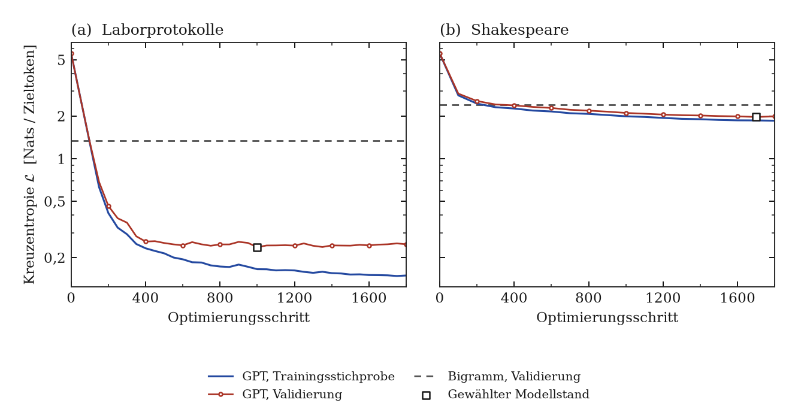

# nabla-flow

`Fach A: Glas. Fach B: Harz. In B liegt `

Der kleine Transformer ergänzt **`Glas.`** Der Satz klingt richtig. Wer ihn liest, merkt sofort, wo der Fehler steckt. Genau dafür gibt es hier neben dem üblichen Sprachmodell-Loss noch eine zweite Auswertung. Sie fragt nach dem Inhalt der Antwort.

Das Projekt fängt bei der [Kettenregel](latex/backprop_first_principles.tex) an und endet bei einem GPT-2-artigen Decoder in C11. Vorwärtsrechnung, Rückwärtsrechnung, Optimierer und Textgenerierung stehen im Quellcode. Zum Ausprobieren gibt es zwei trainierte Modelle. Das eine kennt kurze deutsche Laborprotokolle, das andere einen Ausschnitt aus Shakespeares *Coriolanus*. Derselbe C-Kern läuft auch mit den **124.439.808 Parametern von GPT-2 Small**. Für diese Größe ist ein Funktionstest dokumentiert. Die Sprachversuche unten stammen aus den beiden kleineren Modellen.

**[Lernheft für Word herunterladen](docs/Lernheft.docx?raw=1)** · [C-Kern](src/gpt.c) · [Shakespeare-Versuch mit Textprobe](results/shakespeare/README.md) · [Training in GPT-2-Small-Größe](docs/gpt2-small.md)

## In fünf Minuten ausprobieren

Ein C11-Compiler reicht. Die folgenden Befehle laufen in PowerShell mit GCC. Unter Linux und macOS genügen `make` und `./nablaflow`.

~~~powershell
gcc -O3 -std=c11 -Wall -Wextra -Wpedantic src/main.c src/gpt.c src/data.c src/checkpoint.c src/recall.c src/scale.c -o nablaflow.exe -lm
.\nablaflow.exe check
.\nablaflow.exe sample --model results/model.nfg --prompt "Fach A: Glas. Fach B: Harz. In B liegt " --temperature 0
.\nablaflow.exe recall results/model.nfg data/recall.tsv
~~~

Bei Temperatur null nimmt der Generator jeweils das wahrscheinlichste zulässige Token. Probiere denselben Satz mit `In A liegt `. Die interessante Frage ist, ob sich beim Wechsel von A zu B auch das ausgegebene Material ändert.

## Was lernt das Modell tatsächlich?

Für den ersten Versuch stehen in jeder Zeile zwei Dinge an zwei Orten, etwa zwei Farben oder zwei Materialien. Alle Wörter kommen schon im Training vor. Zurückgehalten werden ganze **Paare**. Glas und Harz sind so ein Testpaar. Ob das Glas in Fach A oder B liegt, macht für die Zuteilung keinen Unterschied. Andernfalls wäre ein gut aussehendes Ergebnis hier ziemlich billig. Der Generator liefert 248 Trainingszeilen, 56 zur Modellwahl und 56 für die abschließende Prüfung. [Datengenerator in C](tools/corpus.c) · [Testzeilen](data/test.txt)

| Versuch | Zieltoken im Test | Bigramm-PPL | Transformer-PPL |
| --- | ---: | ---: | ---: |
| Laborprotokolle, 35.776 Parameter | 2.490 | 3,682 | **1,270** |
| Shakespeare, 43.056 Parameter | 6.819 | 10,696 | **6,981** |

PPL ist die Perplexität, also der Exponentialwert der mittleren negativen Log-Likelihood pro Zieltoken. In beiden Versuchen ist ein Token ein UTF-8-Byte oder das Ende der Zeile. Das Bigramm kennt nur das unmittelbar vorhergehende Token. Der Transformer kann weiter zurücklesen. Die Tabellenzeilen haben unterschiedliche Korpora und Wortschätze. Der aussagekräftige Vergleich steht jeweils **innerhalb** einer Zeile. [Labor-Messung](results/test.csv) · [Shakespeare-Messung](results/shakespeare/test.csv)

Für die Rückfragen zählt nur eine vollständig richtig erzeugte Fortsetzung bis zum Punkt. Das Labormodell schafft **26 von 56**. Eine feste Regel „nimm immer den ersten genannten Wert“ käme bei diesem Aufbau schon auf 28. Ein großer Teil des guten Token-Loss stammt also aus einem leichteren Problem: Satzbau, Leerzeichen und häufige Wortfolgen sind gut vorhersagbar. Wie viel davon auf die einzelnen Satzteile entfällt, müsste man mit einer getrennten Verlustmessung prüfen. [Rückfragen](data/recall.tsv) · [Gemessene Treffer](results/recall.csv)

**Abb. 1.** Kreuzentropie bei zunehmender Zahl von Updates, links für die Laborprotokolle, rechts für Shakespeare. Beide Tafeln haben dieselbe logarithmische Ordinate. Die blaue Linie beruht auf einer festen Stichprobe von 64 Trainingsblöcken. Rot zeigt den ganzen Validierungssplit, das offene Quadrat markiert den gewählten Checkpoint. Beim Laborversuch fällt der Trainingsverlust nach Schritt 1000 weiter, die Validierung erreicht dort ihr Minimum.

Für die Darstellung habe ich mich an zwei Physikabbildungen orientiert. Die gemeinsame Achsenskalierung der beiden Tafeln folgt dem Vergleich in Abb. 4 der Roberge-Weiss-Arbeit. Die offenen Symbole machen die Messpunkte auch im Schwarzweißdruck erkennbar, ähnlich wie in Abb. 5 der Arbeit zur Resonanzunterdrückung. Hier steht jede Kurve für einen einzelnen Trainingslauf. [Chabane und Endrödi, Abb. 4](https://pos.sissa.it/396/097/pdf#page=6) · [Chabane et al., Abb. 5](https://doi.org/10.1103/PhysRevC.111.034913)

## Vom Bigramm zur Attention

Karpathy beginnt mit der schlichten Frage, welches Zeichen nach dem bisherigen Text kommt. Im Bigramm reicht dafür eine Tabelle. Für `Glas` und `Holz` mehrere Wörter zurück braucht das Modell eine Möglichkeit, frühere Positionen einzubeziehen. Dafür ist die Self-Attention zuständig. Jeder Kopf bildet aus den Eingaben drei Projektionen, $Q$, $K$ und $V$. An Position $i$ gilt

$$
a_{ij}=\frac{\exp(q_i^\top k_j/\sqrt{d_h})}{\sum_{m=0}^{i}\exp(q_i^\top k_m/\sqrt{d_h})},\quad j\le i,\qquad o_i=\sum_{j=0}^{i}a_{ij}v_j.
$$

Im C-Code endet die innere Schleife bei `j == i`. Damit kann ein späteres Zeichen die aktuelle Vorhersage auch während des Trainings nicht verraten. Der Test ändert den hinteren Teil einer Sequenz und prüft die früheren Logits bitweise. `inspect` gibt die tatsächlich berechneten Gewichte eines Kopfs als CSV aus. [Vaswani et al., Abschnitt 3.2](https://arxiv.org/abs/1706.03762) · [C-Implementierung und Tests](src/gpt.c)

**Abb. 2.** Attention für den Text `Links: rot.` mit Starttoken, zweiter Block, erster Kopf. Eine Zeile gehört zu einer neuen Abfrageposition. Ihre Gewichte summieren sich zu eins. Die graue Fläche oberhalb der Diagonale ist maskiert. Die Animation deckt die bereits berechneten Präfixzeilen in Eingabereihenfolge auf. Die Skala bleibt von 0 bis 1. `␣` bezeichnet das Leerzeichen. Die Gewichte beschreiben das Mischen der Value-Vektoren in genau diesem Kopf. [Gemessene Matrix](results/attention.csv) · [Statischer Vektorexport](figures/attention.svg)

## Was in einem Block steckt

Die Eingabe ist die Summe aus Token- und Positionsvektor. Es folgen LayerNorm, kausale Multi-Head-Attention und eine Residualaddition. Der zweite Zweig besteht aus LayerNorm und einem MLP mit GELU und vierfacher innerer Breite. Am Ende teilen sich Einbettung und Ausgabeprojektion dieselbe Gewichtsmatrix. Bei der Rückwärtsrechnung müssen beide Beiträge zum Gradienten dieser Matrix addiert werden. Der Optimierer mittelt über alle Zieltoken im Batch, begrenzt die globale Gradientennorm und führt ein AdamW-Update aus. [GPT-2-Bericht, Abschnitte 2.2–2.3](https://cdn.openai.com/better-language-models/language_models_are_unsupervised_multitask_learners.pdf) · [AdamW](https://arxiv.org/abs/1711.05101)

`nablaflow check` prüft alle 1.128 Parameter eines kleinen Testdecoders gegen zentrale finite Differenzen. Die größte absolute Abweichung im Referenzlauf beträgt **6,78 × 10⁻⁵** bei Modellgewichten in Float32. Zum Test gehören außerdem die kausale Maske, UTF-8-Grenzen, die Verschiebung der Zieltoken und ein Modell-Rundlauf durch die Checkpointdatei.

## Den Laborversuch wiederholen

~~~powershell
.\nablaflow.exe train --train data/train.txt --val data/val.txt --out run-labor --steps 1800 --ctx 64 --width 32 --heads 4 --layers 2 --batch 8 --lr 0.002 --eval-every 50 --seed 42
.\nablaflow.exe eval --model run-labor/model.nfg --data data/test.txt --train data/train.txt
.\nablaflow.exe recall run-labor/model.nfg data/recall.tsv
.\nablaflow.exe inspect --model run-labor/model.nfg --prompt "Links: rot." --layer 1 --head 0
~~~

`--out` legt einen neuen Ordner an. `history.csv` enthält die gemessenen Verluste, `summary.csv` die Konfiguration und `model.nfg` die Gewichte des auf der Validierung besten Checkpoints. Hier war das Schritt 1000 von 1800. Der Testsatz bleibt bis nach dieser Auswahl zu. Die beiden kleinen Checkpoints im Repository sind direkt für die Inferenz verwendbar. [Lernhistorie](results/history.csv) · [Konfiguration](results/summary.csv)

Die mitgelieferten Grafiken lassen sich aus den C-Ausgaben neu zeichnen. NumPy und Matplotlib werden dafür gebraucht, Pillow schreibt das GIF.

~~~sh
python -m pip install -r requirements-plot.txt
python tools/plot.py
~~~

## Notizen zum Lernen

Zum Einstieg lohnen sich bei Andrew Ng die Abschnitte über den LMS-Schritt und die Softmax-Regression. Eine Rechnung, die man auf Papier nachprüfen kann, ist mir hier lieber als noch eine Loss-Kurve. Im Heft geht es deshalb zuerst um ein Gewicht, dann um ein Bigramm und erst danach um eine Zeile Attention. Eine Frage fürs eigene Protokoll: „Ist die zweite Kurve eigendlich besser, wenn ich nur nach dem richtigen Wort am Satzende frage?“ [CS229-Vorlesungsnotizen von Andrew Ng und Tengyu Ma](https://cs229.stanford.edu/notes2022fall/main_notes.pdf) · [Arbeitsheft](docs/Lernheft.docx?raw=1)

Karpathys erstes Video ist der Einstieg zum Nachbauen, das zweite der Bezugspunkt für die Modellgröße und den Trainingsablauf. Wer eine Ableitung im C-Code verfolgen will, findet im vorhandenen LaTeX-Skript die Kettenregel auf Rechengraphen, lokale Ableitungen und den Finite-Difference-Check. Das Skript lässt sich im Ordner `latex` mit `pdflatex backprop_first_principles.tex` setzen. [Let's build GPT, ab 8:55](https://www.youtube.com/watch?v=kCc8FmEb1nY&t=535s) · [Let's reproduce GPT-2 (124M)](https://www.youtube.com/watch?v=l8pRSuU81PU) · [Herleitung zur Backpropagation](latex/backprop_first_principles.tex)

Die ursprüngliche Notiz zum Rechengraphen

Ein Knoten speichert seinen Vorwärtswert `data` und die Adjungierte `grad`. Rückwärts werden die Beiträge in umgekehrter topologischer Reihenfolge aufsummiert. Für eine Kante von $u$ nach $w$ lautet die lokale Regel $\bar u \mathrel{+}= \bar w\,\partial w/\partial u$. Genau dieses Plus braucht die gemeinsam genutzte Tokenmatrix im Decoder.

Zur mathematischen Ausarbeitung gehören die Literaturhinweise aus der ersten Fassung: Spivak, *Calculus*, Rudin, *Principles of Mathematical Analysis*, Bishop, *Pattern Recognition and Machine Learning*, Goodfellow, Bengio und Courville, *Deep Learning*, sowie Nocedal und Wright, *Numerical Optimization*.

