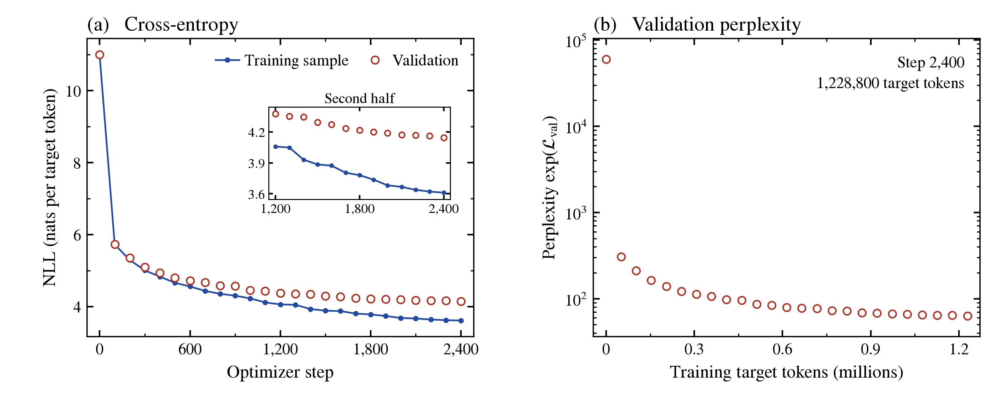
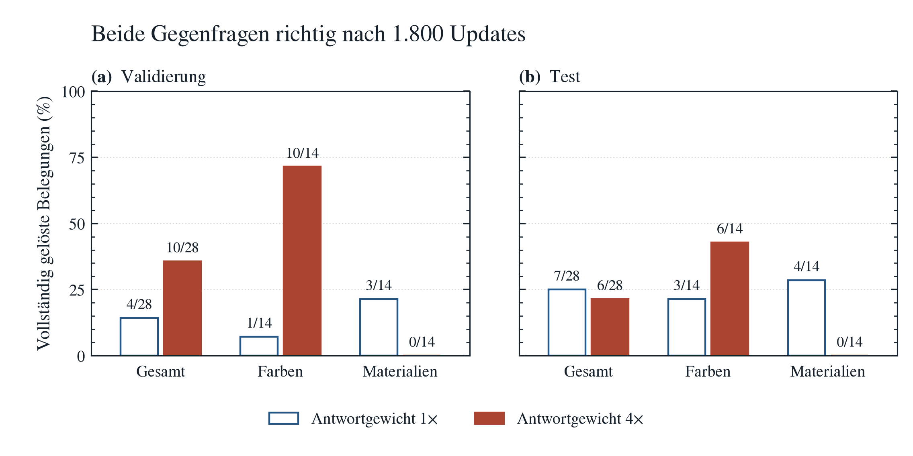
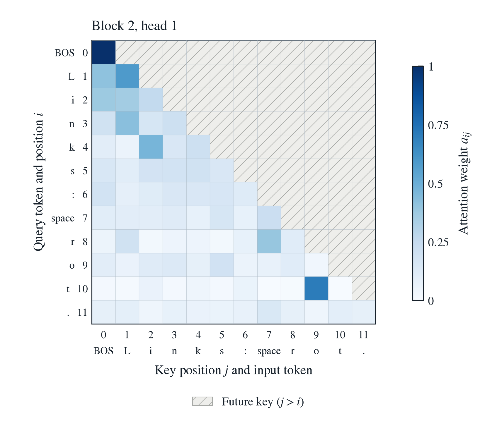

# nabla-flow

## Abstract

- Ich habe zwei Byte-Modelle sowie GPT-2 Small und Medium mit zufälligen Startgewichten trainiert. Beim Lauf mit 355 Millionen Parametern auf meiner RTX 4070 SUPER lag die höchste gemessene Speicherbelegung 6,50 GiB über dem Startwert.
- Beim kleinsten Modell sank der Testverlust mit vierfachem Antwortgewicht von 0,247 auf 0,223 Nats pro Zieltoken. Die Zahl der Testbelegungen mit zwei richtigen Antworten fiel von 7 auf 6 von 28.

## Projektziel

- Ich wollte den Weg von einer falschen Vorhersage bis zur Änderung eines einzelnen Gewichts auf Papier nachvollziehen und die Ableitung im Code überprüfen.
- Zwei Fragen ließen sich am eigenen Rechner testen. Lernt ein Modell die Zuordnung von Material und Fach? Wie viel Speicher brauchen Gewichte, Gradienten und Zwischenwerte bei einem vollständigen GPT-2-Trainingsschritt?

## Was ist ein Parameter?

- Ein Parameter ist eine im Modell gespeicherte Zahl, die sich beim Training ändern kann. Das einfachste Beispiel ist eine Gerade durch den Ursprung, $y=w x$. Hier hat das Modell genau einen Parameter, die Steigung $w$.
- Angenommen, für die Eingabe $x=2$ soll das Ergebnis $1$ sein. Mit $w=0{,}3$ sagt das Modell $0{,}6$ voraus. Ändert das Training $w$ auf $0{,}4$, ergibt dieselbe Eingabe $0{,}8$. Mit $w=0{,}5$ trifft das Modell diesen Datenpunkt genau.
- Im Byte-Modell hat jedes Eingabebyte eine Zeile mit 32 gelernten Zahlen. Im Checkpoint nach 1.000 Updates ist die erste Zahl für `G` −0,0648, die für `H` +0,1039. Jede davon zählt als **ein** Parameter. Insgesamt hat dieses Modell **35.776**. [Gewichte aus dem Checkpoint](figures/byte-weights.svg)

### Das Gewicht für `G` vor und nach dem ersten Update

- Der erste Eintrag für `G` (Byte 71, Spalte 0) startet im Kontrolllauf mit Seed 42 bei **−0,012943409**.
- Im ersten Text des Batches soll nach `Fach A: Sand. Fach B: ` das `G` von `Glas` folgen. Das Modell gibt ihm die Wahrscheinlichkeit $p_G=0{,}00377877$. Die erste Koordinate des letzten Zustandsvektors ist hier $h_0=1{,}01558244$. [Trainingszeile](data/train.txt#L15)
- Für das Ziel `G` ist der Verlust $-\ln p_G=-z_G+\ln\sum_j e^{z_j}$. Ableiten nach dem Ausgabescore $z_G$ ergibt $-1+p_G$. Das Gewicht $w$ geht als $w\,h_0$ in diesen Score ein. Nach der Kettenregel trägt das Token also $(0{,}00377877-1)\cdot1{,}01558244\approx-1{,}011745$ zum Gradienten bei. Im bisherigen Text stand noch kein `G`, daher ist sein Beitrag über die Eingabetabelle hier null.
- Die übrigen 360 Zieltoken tragen zusammen rund **−5,04493** bei. Der Trainer summiert alle Beiträge in FP32. Der mittlere Gradient vor dem Clipping ist damit $-6{,}05667496/361 \approx \mathbf{-0{,}01677749}$. Die einzeln berechneten Beiträge ergeben bei dieser Rundung denselben Mittelwert. [Alle 361 Einzelbeiträge](results/answer-weight/1x/first-batch-token-gradients.csv) · [Summe des Trainers](results/answer-weight/1x/first-update.csv)
- Die Norm des gesamten Batchgradienten beträgt 2,05177. Der Trainer begrenzt sie auf 1 und multipliziert deshalb jede Komponente mit $1/2{,}05177$. Für dieses Gewicht bleibt $g=-0{,}00817707$.
- Beim ersten AdamW-Schritt mit Lernrate $10^{-4}$ und Gewichtszerfall $0{,}01$ gilt $w_1=w_0-10^{-4}\left(\frac{g}{|g|+10^{-8}}+0{,}01\,w_0\right)$. Der Bruch ist hier fast −1. Das Gewicht steigt deshalb um **0,000100013** auf **−0,012843397**, genau wie im FP32-Checkpoint gemessen. [Messwerte](results/answer-weight/1x/first-update.csv) · [Optimiererschritt in C](src/gpt.c#L529-L573)

## Lernskript

- [Vom nächsten Byte zu GPT-2](docs/lernskript/README.md)

## GPT-2 Medium · RTX 4070 SUPER

- [Trainingslauf](results/gpt2-medium-355m/run.json) · 354.823.168 Parameter, FP32, 64 Updates auf *Tiny Shakespeare*, je 4 Fenster à 128 Tokens
- [Validierungsverlust](results/gpt2-medium-355m/history.csv) · 11,096 → 6,365 Nats pro Token

| Grafikspeicher | GiB |
| --- | ---: |
| Gewichte allein | 1,32 |
| [Trainerpuffer einschließlich Gewichten](results/gpt2-medium-355m/memory.csv) | 6,25 |
| Gesamte Karte vor dem Start | 1,42 |
| [Höchste gemessene Kartenbelegung (244 Messpunkte)](results/gpt2-medium-355m/board-memory.csv) | **7,92** |
| Zuwachs gegenüber dem Startwert | **6,50** |

## GPT-2 Small · Tiny Shakespeare

- [Trainingslauf](results/gpt2-124m/history.csv) · 124.439.808 Parameter, 2.400 Updates, 1.228.800 Zieltokens
- 121 s bis zur letzten Validierung, gemessen nach der Initialisierung

| Modell und Datensatz | Verlust (Nats/Token) | Perplexität |
| --- | ---: | ---: |
| [GPT-2 Small, Validierung](results/gpt2-124m/validation-reload.csv) | 4,145 | 63,10 |
| [GPT-2 Small, Test](results/gpt2-124m/test.csv) | 5,171 | 176,05 |
| [Unigramm, derselbe Test](results/gpt2-124m/unigram-test.csv) | 6,684 | 799,28 |

## Byte-Modell · Gewichtung des Antwortworts

- [Vergleich nach 1.800 Updates](results/answer-weight/comparison.csv) · 35.776 identische Startgewichte, gleiche Batches, Seed 42
- [Doppeltreffer](results/answer-weight/pairs.csv) · beide Fragen zur selben Belegung exakt beantwortet

| Belegungen mit Doppeltreffer | Antwortgewicht 1× | Antwortgewicht 4× |
| --- | ---: | ---: |
| Validierung gesamt | 4/28 | 10/28 |
| Test gesamt | 7/28 | 6/28 |
| Test · Farben | 3/14 | 6/14 |
| Test · Materialien | 4/14 | 0/14 |

## Byte-Modelle · Lernkurven und trainierte Gewichte

| Trainingsdaten | Parameter | Update mit kleinstem Validierungsverlust | Testperplexität |
| --- | ---: | ---: | ---: |
| [Laborprotokolle, Antwortgewicht 1×](results/test.csv) | 35.776 | 1.000 | 1,270 |
| [Shakespeare, auf Byte-Ebene](results/shakespeare/test.csv) | 43.056 | 1.700 | 6,981 |

- Labormodell bei Update 1.000 · acht Zeilen der Byte-Embeddings und die Query-Matrix des ersten Kopfs in Block 1

- Derselbe Checkpoint, erster Kopf in Block 2 · bei `Links: rot.` erhält das `o` an der Position des `t` ein Attention-Gewicht von 0,711. [Messwerte](results/attention.csv)

## Quellen

- A. Vaswani et al. (2017). [Attention Is All You Need](https://arxiv.org/abs/1706.03762)
- A. Radford et al. (2019). [Language Models are Unsupervised Multitask Learners](https://cdn.openai.com/better-language-models/language_models_are_unsupervised_multitask_learners.pdf)
- I. Loshchilov & F. Hutter (2019). [Decoupled Weight Decay Regularization](https://arxiv.org/abs/1711.05101)
- A. Karpathy. [Tiny Shakespeare](https://github.com/karpathy/char-rnn/blob/370cbcd448eb7daf32f21a6be560b70e0b33c4e3/data/tinyshakespeare/input.txt)
