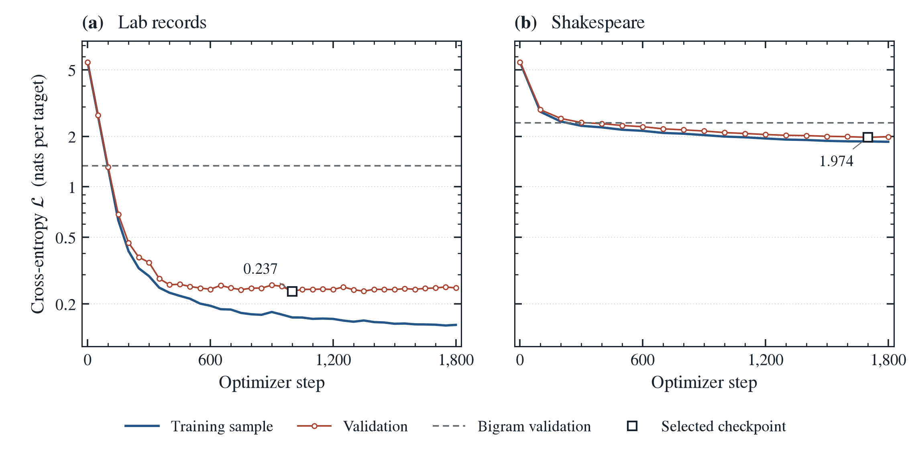
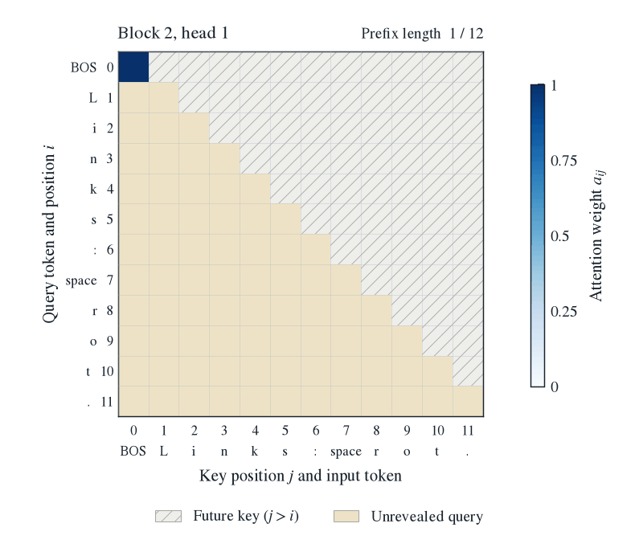

# Two byte-level language models

The smaller decoder has 35,776 parameters. It learns from short German lab records and runs on a CPU. The other has 43,056 parameters and reads part of *Coriolanus*. Both checkpoints are in the repository. Run the commands below from the repository root.

## Try the lab model

A C11 compiler is enough. These are PowerShell commands for GCC. On Linux or macOS, build with `make` and run `./nablaflow`.

~~~powershell
gcc -O3 -std=c11 -Wall -Wextra -Wpedantic src/main.c src/gpt.c src/data.c src/checkpoint.c src/recall.c src/scale.c -o nablaflow.exe -lm
.\nablaflow.exe check
.\nablaflow.exe sample --model results/model.nfg --prompt "Fach A: Glas. Fach B: Harz. In B liegt " --temperature 0
.\nablaflow.exe recall results/model.nfg data/recall.tsv
~~~

The prompt puts glass in compartment A and resin in B, then asks what is in B. At temperature zero the decoder picks the most likely allowed token at each step. Try changing the last few words to `In A liegt `. Does the answer change when the compartment changes?

## Predicting a byte and answering a question

Each lab record assigns two things to two places. The words for both materials or colors already occur in training. The split holds out entire **pairs**. Glass and resin form one test pair, whichever compartment holds the glass. Swapping A and B therefore cannot move a pair from training into the test set. The generator produces 248 training records, 56 for checkpoint selection and 56 for the final test. [C data generator](../tools/corpus.c) · [Test records](../data/test.txt)

| Experiment | Test targets | Bigram perplexity | Transformer perplexity |
| --- | ---: | ---: | ---: |
| Lab records, 35,776 parameters | 2,490 | 3.682 | **1.270** |
| Shakespeare, 43,056 parameters | 6,819 | 10.696 | **6.981** |

Perplexity is the exponential of the mean negative log-likelihood per target. Here the targets are UTF-8 bytes and one end marker per record. The bigram conditions on the preceding token. The Transformer can read farther back in the current window. Compare the two models within each row. The corpora differ in both vocabulary and how predictable the writing is. [Lab results](../results/test.csv) · [Shakespeare results](../results/shakespeare/test.csv)

The recall test scores the whole answer through its final period. The lab model gets **26 out of 56** right. Always copying the first value mentioned would already give 28. Its low perplexity is consistent with learning the fixed sentence pattern, spaces and common byte sequences. To pin down where it saves the most loss, we would need to score the material names separately from the surrounding text. [Recall prompts](../data/recall.tsv) · [Recorded scores](../results/recall.csv)

**Figure 1.** Cross-entropy during training on lab records (left) and Shakespeare (right). Both panels use the same logarithmic vertical scale. The blue curve uses a fixed sample of 64 training blocks. Red markers show the full validation set, and the open square marks the selected checkpoint. In the lab run, validation loss reaches its minimum at step 1,000 while training loss continues to fall.

[Print figure](../figures/learning-curves.pdf) · [Lab measurements](../results/history.csv) · [Shakespeare measurements](../results/shakespeare/history.csv)

The shared scale follows the two-panel comparison in Figure 4 of the Roberge–Weiss paper. The open symbols, used in Figure 5 of the resonance-suppression paper, also work in black and white. Each learning curve here comes from one run. [Chabane and Endrődi, Fig. 4](https://pos.sissa.it/396/097/pdf#page=6) · [Chabane et al., Fig. 5](https://doi.org/10.1103/PhysRevC.111.034913)

## From a bigram to self-attention

Karpathy starts by predicting the next character. A bigram can keep its predictions in a table indexed by the previous character. In the lab data, the words `Glas` and `Holz` can sit several words back from the answer. Self-attention gives each position access to those earlier tokens. A head projects the input into queries $Q$, keys $K$ and values $V$. At position $i$ it computes

$$
a_{ij}=\frac{\exp(q_i^\top k_j/\sqrt{d_h})}{\sum_{m=0}^{i}\exp(q_i^\top k_m/\sqrt{d_h})},\quad j\le i,\qquad o_i=\sum_{j=0}^{i}a_{ij}v_j.
$$

The inner loop in C stops at `j == i`. Even during training, the next character is out of view. One test changes the end of a sequence and checks that the earlier logits stay bit-for-bit identical. The `inspect` command exports the attention weights of a single head as CSV. [Vaswani et al., section 3.2](https://arxiv.org/abs/1706.03762) · [C implementation and tests](../src/gpt.c)

**Figure 2.** Attention in the second block, first head, for the German prompt `Links: rot.` (“Left: red.”), including the start token. Each row gives one query position and sums to one. The hatched upper triangle marks future positions. The animation reveals the measured rows in input order on a fixed scale from 0 to 1. The label `space` marks the space byte. A row shows how this particular head mixes its value vectors. [Measured weights](../results/attention.csv) · [Static vector figure](../figures/attention.svg) · [Print figure](../figures/attention.pdf)

## Inside a decoder block

The input is the sum of the token vector and its position vector. The first branch applies LayerNorm and causal multi-head attention, then adds the residual. The second branch has another LayerNorm and a GELU MLP with four times the embedding width. The token embedding also serves as the output projection, so both uses contribute to its gradient. The optimizer averages the gradients over all target tokens in the batch, clips the global norm and takes one AdamW step. [GPT-2 report, sections 2.2–2.3](https://cdn.openai.com/better-language-models/language_models_are_unsupervised_multitask_learners.pdf) · [AdamW](https://arxiv.org/abs/1711.05101)

`nablaflow check` compares the analytical gradients of all 1,128 parameters in a small test decoder with central finite differences. The largest absolute discrepancy in the reference run was **6.78 × 10⁻⁵** with float32 weights. The tests also cover the causal mask, UTF-8 boundaries, shifted targets and a checkpoint save/load round trip.

## Repeat the lab run

~~~powershell
.\nablaflow.exe train --train data/train.txt --val data/val.txt --out run-lab --steps 1800 --ctx 64 --width 32 --heads 4 --layers 2 --batch 8 --lr 0.002 --eval-every 50 --seed 42
.\nablaflow.exe eval --model run-lab/model.nfg --data data/test.txt --train data/train.txt
.\nablaflow.exe recall run-lab/model.nfg data/recall.tsv
.\nablaflow.exe inspect --model run-lab/model.nfg --prompt "Links: rot." --layer 1 --head 0
~~~

The trainer creates the new `--out` directory. It writes measured losses to `history.csv`, the settings to `summary.csv` and the weights with the lowest validation loss to `model.nfg`. The lab checkpoint came from step 1,000 of 1,800. Scoring on the test set comes after checkpoint selection. Both small checkpoints in the repository are ready for inference. [Loss history](../results/history.csv) · [Run settings](../results/summary.csv)

To regenerate the figures from the C output, install NumPy, Matplotlib and Pillow. Pillow writes the GIF.

~~~sh
python -m pip install -r requirements-plot.txt
python tools/plot.py
python tools/plot_byte_weights.py
~~~

## Pencil-and-paper exercises

The workbook starts with a single weight, moves to a bigram and then works through one row of attention. Andrew Ng's notes on the least mean squares update and softmax regression cover the algebra used in the first exercises. For the lab results, try answering this from the measurements above: if you score only the word that names the material, would you still pick the model with the lower token loss? [CS229 notes by Andrew Ng and Tengyu Ma](https://cs229.stanford.edu/notes2022fall/main_notes.pdf) · [Workbook](workbook.docx?raw=1)

Karpathy's first lecture builds the decoder from a bigram. His second works through the 124M architecture and training loop. The LaTeX notes trace the chain rule through a computational graph and derive the finite-difference check used in the C tests. To typeset them, run `pdflatex backprop_first_principles.tex` in `latex`. [Let's build GPT, from 8:55](https://www.youtube.com/watch?v=kCc8FmEb1nY&t=535s) · [Let's reproduce GPT-2 (124M)](https://www.youtube.com/watch?v=l8pRSuU81PU) · [Backpropagation notes](../latex/backprop_first_principles.tex)

The original computational-graph note

A node stores its forward value in `data` and its adjoint in `grad`. Backpropagation accumulates contributions in reverse topological order. For an edge from $u$ to $w$, the local rule is $\bar u \mathrel{+}= \bar w\,\partial w/\partial u$. The addition matters in the decoder because two paths lead back to the shared token matrix.

References from the original derivation include Spivak's *Calculus*, Rudin's *Principles of Mathematical Analysis*, Bishop's *Pattern Recognition and Machine Learning*, Goodfellow, Bengio and Courville's *Deep Learning*, and Nocedal and Wright's *Numerical Optimization*.

