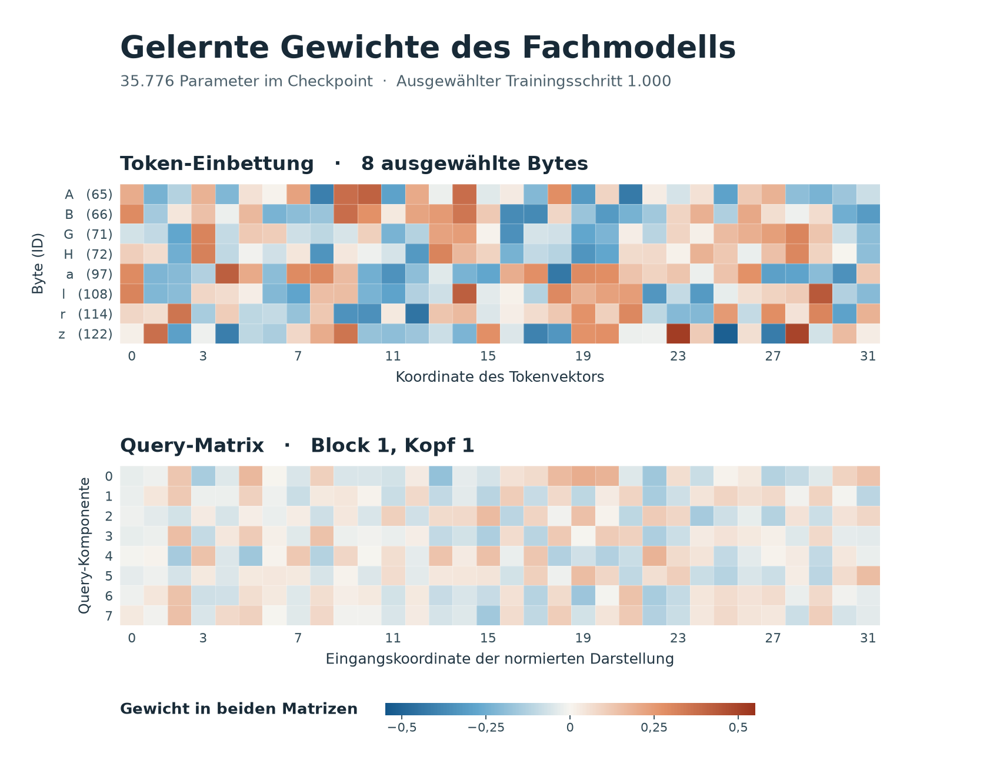
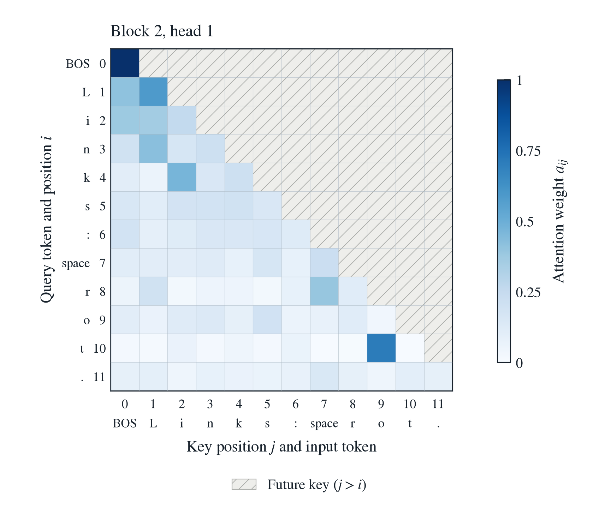

# 2 · Wie greift eine Vorhersage auf frühere Tokens zu?

Stell dir zwei Laborprotokolle vor. Im ersten steht »Fach A: Glas. Fach B: Harz.«, im zweiten sind die Materialien vertauscht. Beide enden mit »In B liegt «. Ein Bigramm sieht in beiden Fällen dasselbe letzte Leerzeichen. Es muss den nächsten Bytes dieselbe Verteilung geben. Wer im ersten Fall ein **H** und im zweiten ein **G** vorhersagen will, braucht einen Rechenweg vom früheren Eintrag zur aktuellen Position. Welche Eigenschaften muss dieser Weg haben?

Er muss frühere Informationen an die passende Stelle bringen, zwischen mehreren Fundstellen unterscheiden und bei der Vorhersage das gesuchte Byte geheim halten. Die letzte Forderung folgt unmittelbar aus der Aufgabe. Für die ersten beiden wählt das Projekt einen lernbaren Mechanismus, die **kausale Selbstaufmerksamkeit**. Wir bauen ihn so auf, dass sich jede dieser Eigenschaften an einer Rechnung prüfen lässt.

## Vom Token zum Zustand

Ein Fenster enthält die Token-IDs $u_0,\ldots,u_{T-1}$. An Position $t$ soll der Decoder eine Verteilung für $u_{t+1}$ liefern. $V$ ist die Vokabulargröße, $C$ die maximale Fensterlänge, $d$ die Breite eines Zustands. Es gilt $T\le C$. Alle Zustände einer einzelnen Position schreiben wir als Spaltenvektoren. Eine Gewichtsmatrix hat eine Zeile je Ausgabekomponente, genau wie bei der C-Funktion `dense`.

Eine Token-ID dient als Index. Die Nummer 76 für das Byte `L` sagt nichts darüber aus, welche Buchstaben im Deutschen ähnliche Rollen spielen. Wir könnten die ID als Einheitsvektor $e_{u_t}\in\mathbb R^V$ kodieren und mit einer gelernten Matrix multiplizieren. Dabei überlebt genau eine Zeile der Tokentabelle $E\in\mathbb R^{V\times d}$. Der Code liest diese Zeile direkt. Hinzu kommt die Zeile $t$ einer zweiten gelernten Tabelle $P\in\mathbb R^{C\times d}$ für die Position im Fenster. Der Anfangszustand ist damit

$$
x_t^{(0)}=E^\top e_{u_t}+P^\top e_t.
$$

Der Einheitsvektor $e_t$ hat hier $C$ Komponenten. Zwei Vorkommen von `B` teilen sich den Tokenanteil und erhalten an unterschiedlichen Stellen verschiedene Positionsanteile. Die Addition ist eine Architekturentscheidung. Sie lässt die Breite $d$ unverändert. [Einbettung in `gpt_forward`](../../src/gpt.c#L274-L293)

## Aus Ähnlichkeit wird eine Leserichtung

Angenommen, jede Position könnte nur den Mittelwert aller bisherigen Zustände lesen. Dann hätten eine passende und fünf unpassende Fundstellen zunächst dasselbe Gewicht. Wir suchen einen **gewichteten** Mittelwert, dessen Gewichte von der aktuellen Frage und den verfügbaren Fundstellen abhängen. Dazu erzeugt ein Kopf aus dem normierten Zustand $r_t$ drei Vektoren. Wie $r_t$ entsteht, rechnen wir weiter unten aus.

$$
q_t=W_Qr_t+b_Q,\qquad
k_j=W_Kr_j+b_K,\qquad
v_j=W_Vr_j+b_V.
$$

Die **Query** $q_t$ beschreibt, wonach Position $t$ sucht. Der **Key** $k_j$ beschreibt, bei welchen Anfragen Position $j$ Gewicht bekommen soll. Der **Value** $v_j$ enthält die Information, die sie dann beiträgt. Drei getrennte Projektionen erlauben beispielsweise, nach einer Fachbezeichnung zu suchen und eine Information über das Material zu übertragen. Ob ein trainierter Kopf eine solche Zuordnung tatsächlich lernt, muss man messen. Die drei Projektionen bekommen an allen Positionen dieselben Gewichte.

Mit $H$ Köpfen ist die Breite eines Kopfes $d_h=d/H$. Jede der drei Matrizen eines Kopfes hat die Form $d_h\times d$. Das Skalarprodukt $q_t^\top k_j$ liefert eine Zahl pro möglicher Fundstelle. Ohne Bias wäre sie $r_t^\top W_Q^\top W_K r_j$. Schon diese Form zeigt, warum die gesuchte Beziehung eine Richtung haben kann. Die gelernte Matrix $W_Q^\top W_K$ braucht keine Symmetrie zu besitzen.

In der oberen Matrix kannst du die Zeile für `G` lesen. Der Eintrag in Spalte 0 beträgt rund $-0{,}065$. In der unteren Matrix ergibt jede Zeile durch ihr Skalarprodukt mit dem normierten Zustand und Addition des zugehörigen Bias eine der acht Query-Komponenten. Die Grafik zeigt gespeicherte Parameter des trainierten Fachmodells. Erst beim Lesen eines konkreten Textes entstehen daraus Queries und Keys für die einzelnen Positionen. [Gewichte des Fachmodells](../../results/model.nfg)

Warum teilen wir das Skalarprodukt durch $\sqrt{d_h}$? Nimm als Überschlagsrechnung unabhängige, zentrierte Query- und Key-Komponenten mit Varianz eins an. Dann hat jedes Produkt $q_{t,i}k_{j,i}$ Varianz eins. Addiert man $d_h$ unabhängige Produkte, erhält die Summe Varianz $d_h$, ihre Standardabweichung wächst also wie $\sqrt{d_h}$. Der folgende Score hält die typische Größenordnung unter dieser Annahme konstant. Sonst könnte allein eine breitere Darstellung Softmax stärker auf den größten Wert zuspitzen. Für gelernte Komponenten ist die Unabhängigkeit eine Näherung.

$$
s_{tj}=\frac{q_t^\top k_j}{\sqrt{d_h}},\qquad 0\le j\le t.
$$

Die Beschränkung $j\le t$ folgt aus dem Vorhersagezeitpunkt. Bei $j=t+1$ läge bereits das Ziel vor. Die eigene Position $j=t$ ist erlaubt, denn $u_t$ ist bekannt. In C endet die Schleife über die Keys bei `j <= t`. [Projektion und kausale Attention im CPU-Code](../../src/gpt.c#L245-L301)

## Warum ergibt sich aus den Scores ein Softmax?

Die Mischung $o_t=\sum_{j=0}^{t}a_{tj}v_j$ soll bei identischen Values wieder genau diesen Value liefern. Das gelingt, wenn sich die Gewichte zu eins summieren. Mit $a_{tj}\geq 0$ liegt das Ergebnis zwischen den angebotenen Values, genauer in ihrer konvexen Hülle. Wie verteilen wir die Masse? Ein hoher mittlerer Score soll sich lohnen. Zugleich sollen mehrere plausible Quellen Gewicht erhalten können.

Dafür können wir für eine Zeile die Gewichte $a_j$ so wählen, dass **mittlerer Score plus Entropie** maximal wird. Die relative Gewichtung beider Terme setzen wir auf eins. Dies ist eine Wahl des Modells. Wir berücksichtigen $\sum_j a_j=1$ mit einem Lagrange-Multiplikator $\lambda$. Alle Summen laufen nur über die erlaubten Positionen.

$$
F(a,\lambda)=\sum_j a_j s_{tj}-\sum_j a_j\ln a_j
                +\lambda\left(1-\sum_j a_j\right).
$$

Am Maximum gilt $0=\partial F/\partial a_j=s_{tj}-\ln a_j-1-\lambda$. Also ist $a_j$ proportional zu $\exp(s_{tj})$. Die zweite Ableitung des Entropieterms nach $a_j$ ist $-1/a_j<0$. Die Normierung legt das eindeutige Maximum fest. Das Programm berechnet die Lösung direkt.

$$
a_{tj}=\frac{\exp(s_{tj}-M_t)}{\sum_{i=0}^{t}\exp(s_{ti}-M_t)},
\qquad M_t=\max_{0\le i\le t}s_{ti}.
$$

Das Abziehen von $M_t$ kürzt denselben Faktor aus Zähler und Nenner. Der größte Exponentialterm ist jetzt eins, auch wenn ein Score etwa 1.000 beträgt. Gleiche Scores liefern gleiche Gewichte. Eine Differenz von $\ln 3$ ergibt ein Gewichtsverhältnis von $3:1$. Für $j>t$ gilt $a_{tj}=0$.

### Eine Zeile von Hand

An Position $t=1$ eines Fensters mit drei Tokens wählen wir in einem einzelnen Kopf $d_h=2$ und $q_1=(\sqrt{2},0)^\top$. Die Zahlen sind zum Rechnen gewählt. Sie beschreiben den Zustand **nach** der Projektion.

| Position $j$ | Key $k_j$ | Value $v_j$ | Score für $q_1$ | Gewicht |
| --- | --- | --- | --- | --- |
| 0 | $(0,1)^\top$ | $(2,0)^\top$ | $0$ | $1/4$ |
| 1 | $(\ln 3,1)^\top$ | $(0,4)^\top$ | $\ln 3$ | $3/4$ |
| 2 | $(10,0)^\top$ | $(9,9)^\top$ | durch die Maske ausgeschlossen | $0$ |

Das zweite Skalarprodukt ist $\sqrt{2}\ln 3$. Nach Division durch $\sqrt{2}$ und Subtraktion des Zeilenmaximums bleiben die Scores $(-\ln 3,0)$. Ihre Exponentialwerte $(1/3,1)$ summieren sich zu $4/3$. Der Kopf liefert

$$
o_1=\tfrac14(2,0)^\top+\tfrac34(0,4)^\top=(1/2,3)^\top.
$$

**Gedankenexperiment.** Vergrößere den ersten Eintrag von $k_2$ auf eine Million. Der ausgerechnete Vektor bleibt $(1/2,3)^\top$. Genau daraus folgt ein Test für den gesamten Decoder. Token- und Positionsvektoren des festen Präfixes bleiben identisch. Jede Attention-Zeile dieses Präfixes liest nur daraus. Alle übrigen Operationen wirken je Position. Das Argument gilt nach jedem weiteren Block wieder. Der CPU-Selbsttest ändert in einer Fünferfolge die beiden letzten IDs und vergleicht alle früheren Logits bitweise. Er prüft auch den auf drei IDs abgeschnittenen Präfix. [Kausalitätstest](../../src/gpt.c#L577-L602)

## Wie baut das Projekt aus Köpfen einen Decoderblock?

Mehrere Köpfe dürfen für dieselbe Query-Position unterschiedliche Gewichtsverteilungen bilden. Wir hängen ihre $d_h$-dimensionalen Ergebnisse aneinander. Die Gesamtlänge ist $Hd_h=d$. Eine gelernte Matrix $W_O\in\mathbb R^{d\times d}$ mischt die Komponenten. Im Speicher bildet der Code alle Queries, Keys und Values eines Tokens mit einer einzigen Projektion $d\to 3d$ und greift für jeden Kopf auf den zugehörigen Ausschnitt zu. [Gewichtsanordnung](../../src/gpt.c#L41-L61) · [Attention-Schleifen](../../src/gpt.c#L245-L272)

Was passiert vor den Projektionen? Bei jeder Position kann der Zustand im Verlauf des Trainings seine Größenordnung verändern. Eine **LayerNorm** misst Mittelwert und Varianz über die $d$ Komponenten **dieser einen Position**. Für den Vektor $x$ gilt

$$
\mu=\frac1d\sum_i x_i,\qquad
\sigma^2=\frac1d\sum_i(x_i-\mu)^2,\qquad
\operatorname{LN}(x)_i=\gamma_i\frac{x_i-\mu}{\sqrt{\sigma^2+10^{-5}}}+\beta_i.
$$

Eine gemeinsame additive Verschiebung aller Komponenten fällt durch die Subtraktion von $\mu$ weg. Bei $x=(1,3)^\top$ erhält man $\mu=2$ und $\sigma^2=1$. Mit $\gamma=(1,1)^\top$ und $\beta=(0,0)^\top$ ergibt sich näherungsweise $(-1,1)^\top$. Ein konstanter Eingangsvektor hat Varianz null und liefert dank des kleinen positiven Terms genau $\beta$. Die lernbaren Parameter $\gamma,\beta$ geben jeder Komponente wieder einen eigenen Maßstab und Nullpunkt. [LayerNorm auf der CPU](../../src/gpt.c#L216-L233)

Für einen Block mit Eingang $x_t$ schreiben wir die beiden aufeinanderfolgenden Aktualisierungen aus. Die erste fügt jeder Position Informationen aus ihrem Präfix hinzu, die zweite verarbeitet die neuen Merkmale an dieser Position.

$$
\begin{aligned}
r_t &= \operatorname{LN}_1(x_t),\\
m_t &= x_t + W_O [o_t^{(1)};\dots;o_t^{(H)}]+b_O,\\
n_t &= \operatorname{LN}_2(m_t),\\
f_t &= \operatorname{GELU}(W_1n_t+b_1),\\
x'_t &= m_t + W_2 f_t+b_2.
\end{aligned}
$$

Die eckige Klammer hängt die Kopfvektoren aneinander. Die Normalisierung steht jeweils **vor** der Verarbeitung durch den Zweig. Daher heißt diese Bauweise *Pre-LayerNorm*. Die beiden Additionen sind **Residualverbindungen**. Gibt ein Zweig den Nullvektor aus, steht sein Eingang für den nächsten Schritt weiterhin zur Verfügung.

Der zweite Zweig ist ein kleines neuronales Netz (MLP). $W_1$ vergrößert die Breite von $d$ auf $4d$, $W_2$ verkleinert sie auf $d$. Zwei affine Abbildungen hintereinander ließen sich zu einer einzigen zusammenfassen. Die Nichtlinearität dazwischen erlaubt eine merkmalsabhängige Verarbeitung. GPT-2 wählt für jedes Skalarargument $a$ die Funktion GELU. Ihre Grundidee lässt sich mit einem Schwellenexperiment lesen. Sei $\xi$ standardnormalverteilt. Lässt man $a$ passieren, wenn $\xi\le a$, ergibt sich als Erwartungswert $a\,\Pr(\xi\le a)=a\Phi(a)$. Der Code verwendet dafür die deterministische Näherung

$$
\operatorname{GELU}(a)\approx \frac a2
\left[1+\tanh\left(\sqrt{2/\pi}\,(a+0.044715a^3)\right)\right].
$$

Für $a=0$ erhält man null. Für große positive Argumente geht der Faktor in der eckigen Klammer gegen zwei, für große negative gegen null. Sowohl GELU als auch die Breite $4d$ sind Entscheidungen dieser Architektur. [Beide Residualzweige und GELU in `gpt_forward`](../../src/gpt.c#L290-L308)

## Vom Zustand zur Vorhersage

Nach $L$ Blöcken normalisiert der Decoder den letzten Zustand nochmals. Mit $h_t=\operatorname{LN}_f(x_t^{(L)})$ erhält jedes mögliche nächste Token $k$ einen **Logit** $z_{t,k}$. Dazu wird dieselbe Tabellenzeile $E_{k,:}$ benutzt, aus der am Eingang der Vektor für Token $k$ stammt.

$$
z_{t,k}=\sum_{i=1}^d E_{k,i}\,h_{t,i},\qquad
p(u_{t+1}=k\mid u_0,\ldots,u_t)=
\frac{\exp(z_{t,k})}{\sum_{v=0}^{V-1}\exp(z_{t,v})}.
$$

Die Attention normalisiert über **frühere und aktuelle Positionen**. Die Ausgabeverteilung normalisiert über **mögliche nächste Token-IDs**. So kann ein Attention-Gewicht von $0{,}75$ an einer Stelle zu einem beliebigen Ausgabetoken beitragen. Dafür sind auch Value, andere Köpfe, MLP und Ausgabematrix entscheidend.

Im CPU-Code erzeugt `gpt_forward` die Logits. `token_objective` wertet daraus die Kreuzentropie mit abgezogenem Zeilenmaximum aus. Die Ausgabeschicht hat keinen eigenen Bias. Die gemeinsame Matrix $E$ erhält beim Lernen Beiträge über ihren Eingangspfad und ihren Ausgangspfad. [Finale Normierung und Ausgabe](../../src/gpt.c#L307-L315) · [Berechnung der Zielfunktion](../../src/gpt.c#L410-L447)

### Zählen als unabhängige Kontrolle

| Bestandteil | Zahl der gelernten Skalare |
| --- | ---: |
| Einmalig für Token- und Positionstabelle | $(V+C)d$ |
| Q, K, V und Ausgangsprojektion pro Block, mit Bias | $4d^2+4d$ |
| MLP pro Block, mit Bias | $8d^2+5d$ |
| Zwei LayerNorms pro Block, je Skala und Offset | $4d$ |
| Finale LayerNorm | $2d$ |

Damit ist $N=(V+C)d+L(12d^2+13d)+2d$. Beim deutschen Bytemodell ergeben $V=258$, $C=64$, $d=32$, $L=2$ genau **35.776**. Für GPT-2 Small ergeben $V=50\,257$, $C=1\,024$, $d=768$, $L=12$ genau **124.439.808**. Der große Lauf benutzt $T=128$ Positionen pro Trainingsfenster. Für die Parameterzahl zählt die Größe $C$ der angelegten Tabelle. Bei festem $d$ ändert eine andere zulässige Kopfzahl $H$ nur die Aufteilung der Projektionen. [Parameterzählung in C](../../src/gpt.c#L101-L113) · [Messprotokoll des Bytemodells](../../results/summary.csv) · [Konfiguration des großen Laufs](../training-124m.md)

## Vom Papier zur Messung

**Versuch.** Welche Zahlen muss die Zeile zur ersten Position von `Links: rot.` zeigen, wenn der Decoder zuerst einen Startmarker einfügt? Welche Einträge können in der zweiten Zeile überhaupt von null verschieden sein? Lege dich fest und führe dann im Repository-Hauptverzeichnis den CPU-Befehl aus. Das verwendete Modell ist bereits mitgeliefert. [Bauanleitung für das CPU-Programm](../byte-models.md)

~~~powershell
.\nablaflow.exe inspect --model results/model.nfg --prompt "Links: rot." --layer 1 --head 0 |
    ConvertFrom-Csv | Where-Object { [int]$_.query_pos -lt 2 -and [int]$_.key_pos -lt 3 } |
    Format-Table query_pos,key_pos,weight
~~~

**Auflösung.** Die erste Zeile muss vollständig auf dem Startmarker liegen. Die zweite darf nur den Startmarker und das Byte `L` lesen. Im zweiten Block, ersten Kopf (im Befehl ab null gezählt) meldet die gespeicherte Messung für diese beiden Quellen ungefähr $0{,}412516$ und $0{,}587484$. Ihre Summe ist bis auf Rundung eins. Das Verhältnis erlaubt sogar einen Rückschluss auf die **Differenz** der beiden Scores, $\ln(0{,}587484/0{,}412516)\approx0{,}354$. Eine gemeinsame Konstante in den Scores ist aus dieser Messung prinzipiell unbestimmbar. [Vollständige Attention-Zeilen](../../results/attention.csv) · [Grafische Ansicht](../../figures/attention.svg)

Suche die Zeile zum Buchstaben `t` und fahre von links nach rechts. Ihr dunkelstes Feld liegt in der Spalte `o` unmittelbar davor. In den Messdaten beträgt dieses Gewicht $0{,}711$. Der Kopf übernimmt also an dieser Stelle rund 71 Prozent seiner Mischung aus dem Value-Vektor bei `o`. Um daraus eine Vorhersage für das nächste Zeichen zu berechnen, braucht man auch die Value-Vektoren und die folgenden Schichten. Die grauen Felder sind durch die kausale Maske ausgeschlossen. [Messdaten für diese Abbildung](../../results/attention.csv)

**Transferaufgabe.** Verdopple bei unverändertem $d$ die Anzahl der Köpfe, sofern $d$ durch die neue Kopfzahl teilbar ist. Wie ändern sich Kopfbreite, Parameterzahl und Anzahl der berechneten zulässigen Scores je Block in einem Fenster der Länge $T$?

**Lösung.** Die Kopfbreite halbiert sich. Jede der drei Projektionen behält über alle Köpfe hinweg $d$ Ausgänge, daher bleibt $N$ gleich. Ein Kopf benötigt $1+2+\cdots+T=T(T+1)/2$ zulässige Scores. Über alle Köpfe verdoppelt sich ihre Anzahl auf $2H\cdot T(T+1)/2$. Jedes einzelne Skalarprodukt verarbeitet dann halb so viele Komponenten.

Wer die Rechenwege auf der GPU verfolgt, findet dieselbe Reihenfolge in `forward` in `src/gpu.c`. Die dichten Matrixprodukte laufen über cuBLAS. Im CUDA-Kernel `attention` bearbeitet ein Threadblock die Kombination aus **einer Sequenz, einer Query-Position und einem Kopf**. Im Batch kann daher jedes Beispiel nur seine eigene Sequenz lesen. Die unterschiedlichen Summationsreihenfolgen auf CPU und GPU machen numerische Toleranzen sinnvoll. Die projektinterne Paritätsprüfung vergleicht unter anderem Logits und Gradienten beider Pfade. [GPU-Vorwärtspfad](../../src/gpu.c#L376-L400) · [CUDA-Attention](../../src/gpu_kernels.cu#L108-L133) · [CPU/GPU-Paritätsprüfung](../../src/gpu.c#L479-L547)

Was müsste man an den beiden Scores unserer Handrechnung ändern, damit die erste Komponente des Kopfvektors kleiner wird? Diese Frage eröffnet den Rückweg. [Weiter zu Kapitel 3](03-lernen.md) · [Übersicht](README.md)
