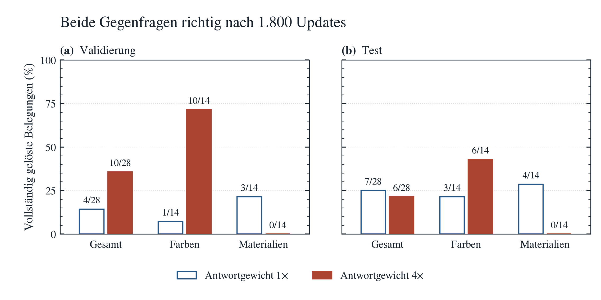

# 5 · Was ändert sich, wenn das Antwortwort vierfach zählt?

`Fach A: Glas. Fach B: Harz. In B liegt Harz.` enthält das Wort `Harz` zweimal. Beim ersten Mal nennt der Text den Inhalt eines Fachs. Beim zweiten Mal muss das Modell diesen Inhalt aus dem vorangegangenen Text erschließen. Der gewöhnliche Trainingsverlust behandelt beide Vorkommen gleich. In diesem Versuch zählen nur beim zweiten Vorkommen die Fehler vierfach. Nach dem Training bekommt das Modell zu jeder Belegung zwei Fragen, eine nach jedem Fach.

## Ein Eingriff in die Zielfunktion

Für das Zielbyte $y_i$ mit vorangegangenem Text $c_i$ ist der Verlust $\ell_i=-\ln p_\theta(y_i\mid c_i)$. Im Kontrolllauf gilt überall $w_i=1$. Im zweiten Lauf haben die vier Zielbytes `H`, `a`, `r`, `z` des letzten `Harz` jeweils $w_i=4$. Die erste Erwähnung, das Leerzeichen vor der Antwort, der Punkt und der Endmarker behalten Gewicht eins. Bei einem `ü` im Antwortwort zählt jedes seiner beiden UTF-8-Bytes vierfach. [Markierung der Antwortbytes](../../src/data.c)

Für die Zielpositionen eines Batches berechnet das Training

$$
L_B=\frac{\sum_i w_i\ell_i}{\sum_i w_i},
\qquad
\frac{\partial L_B}{\partial z_{ik}}
=\frac{w_i}{\sum_j w_j}\bigl(p_\theta(k\mid c_i)-\mathbf 1_{k=y_i}\bigr).
$$

Dabei ist $z_{ik}$ der Logit für Klasse $k$ an Position $i$. Das Verhältnis der Gewichte eines Antwortbytes und eines gewöhnlichen Bytes wächst von $1:1$ auf $4:1$. Der Nenner $\sum_j w_j$ ändert sich dabei ebenfalls. Im Trainingskorpus gehören 1.000 von 10.998 Zielen zum Antwortwort. Auf diese Bytes entfallen bei einfacher Gewichtung $1\,000/10\,998=9{,}09\,\%$ des Gesamtgewichts, bei vierfacher Gewichtung $4\,000/(9\,998+4\,000)=28{,}58\,\%$. Der Trainer normiert für jeden Batch mit dessen eigener Gewichtssumme. [Trainingskorpus](../../data/train.txt) · [Gradient und Optimierung](../../src/gpt.c)

## Kontrolllauf und Messgröße

Der Byte-Decoder hat 35.776 Parameter, zwei Blöcke, vier Köpfe und eine Breite von 32. Beide Läufe starten mit Seed 42 und sehen dieselben 248 Trainingszeilen in derselben Batchfolge. Batchgröße 8, Kontextlänge 64, AdamW und der Lernratenverlauf mit Spitzenwert 0,002 sind gleich. Nach 1.800 Updates endet das Training. Der für die Auswertung protokollierte Verlust gewichtet jedes Ziel einfach. [Trainingsschleife](../../src/main.c)

Der erste Vergleich verwendet den Stand nach genau 1.800 Updates. Für den zweiten Vergleich gilt die Auswahlregel des ursprünglichen Fachmodells. Gespeichert wird der Stand mit dem niedrigsten mittleren Verlust auf der Validierung (NLL), gemessen bei Schritt 0 und danach alle 50 Schritte. Je nach Lauf ergibt das einen anderen Auswertungszeitpunkt.

Ein **Doppeltreffer** zählt nur, wenn `recall` für dieselbe Belegung beide Antworten bis einschließlich Punkt exakt erzeugt. Bei den Materialien wird nach Fach A und Fach B gefragt, bei den Farben nach links und rechts. In der Validierung ergeben 14 Wortpaare mit je zwei Anordnungen 28 Belegungen und insgesamt 56 Fragen. Wer immer das zuerst genannte Wort kopiert, erreicht 28 von 56 Einzelantworten und 0 von 28 Doppeltreffern. [Validierungszeilen](../../data/val.txt) · [Paarbildung und Bewertung](../../tools/recall_pairs.py)

## Messung

Die Prüfsumme der Startgewichte (FNV-1a) lautet in beiden Läufen `aa301ceacc78564c`, die Validierungs-NLL vor dem ersten Update jeweils 5,55346731407. Der bei Schritt 1.000 ausgewählte 1×-Checkpoint ist bytegleich mit `results/model.nfg`. Bei einer Wiederholung unter Windows mit GCC 14.2.0 waren alle vier Checkpoints und beide Verlustkurven bytegleich mit denen des ersten Versuchs. [Protokoll 1×](../../results/answer-weight/1x/summary.csv) · [Protokoll 4×](../../results/answer-weight/4x/summary.csv)

| Vergleich | Antwortgewicht | Schritt | Beide richtig, Validierung | Einzelantworten, Validierung | Beide richtig, Test | Einzelantworten, Test |
| --- | ---: | ---: | ---: | ---: | ---: | ---: |
| Festes Trainingsende | 1× | 1.800 | 4/28 | 29/56 | 7/28 | 34/56 |
| Festes Trainingsende | 4× | 1.800 | **10/28** | **38/56** | 6/28 | 32/56 |
| Minimum der Validierungs-NLL | 1× | 1.000 | 0/28 | 20/56 | 3/28 | 26/56 |
| Minimum der Validierungs-NLL | 4× | 1.350 | **8/28** | **35/56** | **8/28** | **34/56** |

Bei Schritt 1.800 löst der 4×-Lauf auf der Validierung neun Belegungen, die der 1×-Lauf verfehlt. Drei Doppeltreffer des 1×-Laufs gehen verloren. Die Differenz ist $9-3=6$. Im Test stehen fünf zusätzlichen Doppeltreffern sechs verlorene gegenüber. Die Checkpoints standen vor dieser Testauswertung fest. Der Testsatz war aus früheren Projektversuchen bekannt. [Alle acht Messungen einschließlich NLL](../../results/answer-weight/comparison.csv) · [Ergebnis jeder Belegung](../../results/answer-weight/pairs.csv)

### Welche Aufgabe profitiert?

**Abbildung 1.** Anteil der Belegungen mit zwei richtigen Antworten nach 1.800 Updates. Der Bruch über jedem Balken nennt die Zahl der Doppeltreffer und der geprüften Belegungen. Links steht die Validierung, rechts der Test. [Druckfassung](../../results/answer-weight/paired-recall.pdf) · [Plotskript](../../tools/plot_answer_weight.py)

| Belegungstyp bei Schritt 1.800 | Validierung 1× → 4× | Test 1× → 4× |
| --- | ---: | ---: |
| Farben mit `Links` und `Rechts` | 1/14 → **10/14** | 3/14 → **6/14** |
| Materialien in `Fach A` und `Fach B` | 3/14 → **0/14** | 4/14 → **0/14** |

Bei `Links: beige. Rechts: lila.` beantwortet der Kontrolllauf eine Frage richtig, der 4×-Lauf beide. Bei `Fach A: Blei. Fach B: Glas.` geschieht das Umgekehrte. Der Unterschied zwischen Farben und Materialien zeigt sich auch im 4×-Checkpoint bei Schritt 1.350. Alle acht Doppeltreffer in der Validierung und alle acht im Test entfallen auf Farben. [Rohdaten nach Belegung](../../results/answer-weight/pairs.csv)

### Warum sinkt der Testverlust, obwohl ein Doppeltreffer verloren geht?

Bei Schritt 1.800 sinkt die ungewichtete Test-NLL von 0,24687 auf 0,22332 Nats pro Zieltoken. Sie mittelt über 2.490 Positionen. Auch wenn das Modell an einer Position dasselbe Byte wie zuvor wählt, kann eine höhere Wahrscheinlichkeit für das richtige Byte den Verlust senken. Ein Doppeltreffer verlangt dagegen zwei fehlerfreie Antworten. Schon ein falscher Anfangsbuchstabe bei einer der beiden kostet den ganzen Treffer.

Farben kommen im Korpus immer mit `Links/Rechts` vor, Materialien immer mit `A/B`. Deshalb lässt sich aus diesem Lauf nicht ablesen, ob die Wörter oder die Satzform den Unterschied erklären. Ein Folgeversuch könnte beide Wortgruppen mit beiden Satzformen kombinieren und die vier Fälle einzeln auswerten. Bisher gibt es je Aufgabentyp und Auswertungssatz 14 Belegungen und ein gemeinsames Paar von Startgewichten. Weitere gepaarte Läufe mit neuen Seeds würden zeigen, wie stark das Ergebnis mit der Initialisierung schwankt.

## Befehle für die Wiederholung

Die Befehle laufen in PowerShell vom Stammverzeichnis des Repositorys aus. Der CPU-Trainer benötigt GCC mit C11-Unterstützung, die Paarwertung Python 3. `$py` bezeichnet den installierten Interpreter. Jeder Durchgang schreibt in einen neuen Ordner.

~~~powershell
$runDir = New-Item -ItemType Directory -Path ('run-antwortgewicht-' + [Guid]::NewGuid().ToString('N'))
$nf = Join-Path $runDir.FullName 'nablaflow.exe'
$py = 'python'
gcc -O3 -std=c11 -Wall -Wextra -Wpedantic src/main.c src/gpt.c src/data.c src/checkpoint.c src/recall.c src/scale.c -o $nf -lm
if ($LASTEXITCODE) { throw 'Build fehlgeschlagen' }
& $nf check
if ($LASTEXITCODE) { throw 'Selbsttest fehlgeschlagen' }

$settings = @('--train','data/train.txt','--val','data/val.txt','--steps','1800',
    '--ctx','64','--width','32','--heads','4','--layers','2','--batch','8',
    '--lr','0.002','--eval-every','50','--seed','42','--save-final','1')
foreach ($factor in 1,4) {
    $out = Join-Path $runDir.FullName ("{0}x" -f $factor)
    & $nf train @settings --answer-weight $factor --out $out
    if ($LASTEXITCODE) { throw "Training fehlgeschlagen (Faktor $factor)" }
    Import-Csv (Join-Path $out 'summary.csv') | Format-Table answer_weight,initial_parameters_fnv1a64,best_step
}
~~~

`final.nfg` enthält den Endstand, `model.nfg` den nach Validierungs-NLL ausgewählten Stand. Der folgende Block gibt für jeden Vergleich `both` (Doppeltreffer) und `exact` (korrekte Einzelantworten) als Teil der JSON-Ausgabe aus. Die CSV-Dateien erlauben den direkten Vergleich derselben Belegung über die beiden Läufe.

~~~powershell
foreach ($factor in 1,4) {
    $out = Join-Path $runDir.FullName ("{0}x" -f $factor)
    foreach ($state in 'final','model') {
        foreach ($split in 'val','test') {
            Write-Output "$factor x / $state / $split"
            $weights = Join-Path $out "$state.nfg"
            $detail = Join-Path $out "$state-$split.csv"
            & $py tools/recall_pairs.py --exe $nf --model $weights --data "data/$split.txt" --details $detail
            if ($LASTEXITCODE) { throw 'Paarwertung fehlgeschlagen' }
            & $nf eval --model $weights --data "data/$split.txt"
            if ($LASTEXITCODE) { throw 'NLL-Auswertung fehlgeschlagen' }
        }
    }
}
~~~

Wer nur die Paarwertung wiederholen möchte, kann den veröffentlichten 4×-Checkpoint direkt verwenden. Mit `$py` und `$nf` aus dem Build-Abschnitt ergibt der folgende Befehl auf der Validierung `both = 10` bei `allocations = 28`.

~~~powershell
& $py tools/recall_pairs.py --exe $nf --model results/answer-weight/4x/final.nfg --data data/val.txt
~~~

[Gespeicherte Läufe und Gewichte](../../results/answer-weight/) · [Weiter zu Modellgröße, GPT-2 und GPT-3](06-modellgroesse.md) · [Übersicht](README.md)
