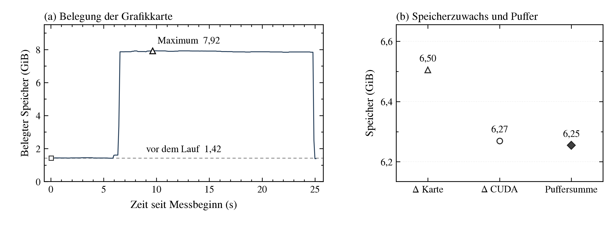

# 7 · Passt GPT-2 Medium zum Training auf eine 12-GB-Karte?

**Ja, für vier Fenster mit je 128 Tokens.** Eine RTX 4070 SUPER führte 64 vollständige Trainingsschritte eines zufällig initialisierten GPT-2 Medium mit **354.823.168 Parametern** aus. Die beiden großen CUDA-Speicherreservierungen des Trainers umfassten zusammen **6,25 GiB**. Die höchste beobachtete Belegung der *gesamten Karte* lag bei **7,92 GiB**. Um diese Zahlen einzuordnen, verfolgen wir ein Gewicht vom Checkpoint bis zu seinem ersten Update.

**Abbildung 1.** Panel (a) zeigt 244 Abfragen der gesamten Karte. Das Quadrat markiert den Ausgangswert, das Dreieck die höchste gemessene Belegung. In Panel (b) steht das Dreieck für die Differenz aus beiden. Der offene Kreis zeigt den größten Zuwachs an den synchronisierten CUDA-Messpunkten gegenüber dem aktiven Kontext vor cuBLAS. Die Raute ist die aus dem Trainer berechnete Puffersumme. Die Ordinatenskalen unterscheiden sich. [Druckfassung](../../results/gpt2-medium-355m/memory.pdf) · [Animation der 244 Messpunkte](../../results/gpt2-medium-355m/memory.gif)

Auf der Zeitachse liegt vor dem Anstieg auch die Erzeugung der Startgewichte auf der CPU. Der Abfall am Ende gehört zum Beenden des Trainers. Die Zeitachse stammt vom äußeren Messprogramm. Die interne Trainingsuhr startet erst nach der GPU-Initialisierung. [Messpunkte der Karte](../../results/gpt2-medium-355m/board-memory.csv) · [CUDA-Messpunkte](../../results/gpt2-medium-355m/memory.csv) · [Maschinenlesbares Versuchsprotokoll](../../results/gpt2-medium-355m/run.json)

## 1. Was wird trainiert?

Der Decoder hat 24 Blöcke, eine Breite von 1.024 und 16 Köpfe pro Block. Ein Kopf verarbeitet also $1\,024/16=64$ Komponenten. Das MLP erweitert die Darstellung vorübergehend auf 4.096 Komponenten. Die Tokentabelle enthält 50.257 Einträge, die Positionstabelle 1.024. Das sind die veröffentlichten GPT-2-Medium-Abmessungen. Der Versuch nutzt pro Trainingsfenster die ersten 128 Positionen. Alle Modellgewichte starten aus der Initialisierung dieses Projekts. [Originalkonfiguration](https://openaipublic.blob.core.windows.net/gpt-2/models/355M/hparams.json) · [Konfiguration und Trainingsschleife](../../tools/nfgpu.c)

Die Parameterformel aus Kapitel 2 gibt mit Vokabular $V$, Positionszahl $C$, Breite $d$ und Blockzahl $L$

$$
N=(V+C)d+L(12d^2+13d)+2d
=354\,823\,168.
$$

Ein Parameter belegt als FP32-Zahl vier Byte. Der reine Gewichtssatz braucht $4N=1\,419\,292\,672$ Byte oder **1,322 GiB**. Der gespeicherte Checkpoint ist genau 300 Byte größer. Seine Zusatzbytes enthalten unter anderem Modellabmessungen und Prüfsumme. Ein GiB entspricht $2^{30}$ Byte, ein MiB $2^{20}$ Byte. [Parameterzählung](02-transformer.md#zählen-als-unabhängige-kontrolle) · [Checkpointformat](../../src/checkpoint.c)

## 2. Warum braucht das Training mehr als der Gewichtssatz?

Nimm einen Eintrag der Query-Matrix. Im Vorwärtslauf liest die GPU seinen aktuellen Wert. Im Rückwärtslauf sammelt sie die Ableitung des Verlusts nach diesem Wert. AdamW hält zusätzlich einen gleitenden Mittelwert der Ableitung und einen Mittelwert ihres Quadrats. Der Trainer reserviert für jede dieser vier Größen ein FP32-Feld mit $N$ Einträgen. Für alle Parameter zusammen ergibt das **$16N=5\,677\,170\,688$ Byte**.

Die Vorwärtsrechnung erzeugt außerdem Zwischenwerte, die der Rückwärtslauf wieder braucht. Bei $B=4$ und $T=128$ verarbeitet ein Batch 512 Positionen. Allein die Logits brauchen $512\cdot50\,257\cdot4=102\,926\,336$ Byte. Für die Attention legt jeder Block ein dichtes Feld mit $B\cdot H\cdot T^2$ FP32-Einträgen an. Bei 16 Köpfen sind das 4 MiB pro Block und 96 MiB für die 24 Blöcke. Die Kausalmaske beschränkt, auf welche Positionen ein Token zugreifen darf. Die Implementierung reserviert das ganze Quadrat. [Pufferaufteilung in `allocate_state`](../../src/gpu.c) · [CUDA-Kernel](../../src/gpu_kernels.cu)

| Was der Speicheraufruf reservierte | Byte | GiB |
| --- | ---: | ---: |
| Gewichte, Gradienten, beide Adam-Momente | 5.677.170.688 | 5,2873 |
| Gemeinsamer Puffer für Zwischenwerte, Logits und Rechenhilfen | 1.038.462.976 | 0,9671 |
| **Summe** | **6.715.633.664** | **6,2544** |

Die Implementierung reserviert beide Bereiche vor dem ersten Trainingsschritt und verwendet sie danach für jeden Batch erneut. Dadurch entsteht das lange Plateau in der Grafik.

## 3. Wie wurde der Verbrauch gemessen?

| Beobachter | Bezugspunkt | Höchster beobachteter Stand | Zunahme |
| --- | ---: | ---: | ---: |
| CUDA-Treiber, `cuMemGetInfo` | 1,202 GiB belegt unmittelbar nach Anlage des CUDA-Kontexts | 7,471 GiB an den synchronisierten Messpunkten | **6,270 GiB** |
| `nvidia-smi`, ganze Karte | 1.450 MiB unmittelbar vor Prozessstart | 8.111 MiB im laufenden Prozess | **6.661 MiB = 6,505 GiB** |

Die interne Messung synchronisiert die GPU und liest den vom Treiber gemeldeten freien und gesamten Speicher. Sie erfasst den Kontext vor dem Laden der Rechenbibliotheken, die fertig geladenen Bibliotheken, die Puffer nach dem Hochladen der Startgewichte sowie die Auswertung, den Rückwärtslauf und das Update an protokollierten Schritten. Nach dem Hochladen lag der belegte Speicher 6.420 MiB über der ersten Kontextmessung. Zwischen dieser Zunahme und den expliziten Puffern liegen rund 15,5 MiB. [Interne Rohmessung](../../results/gpt2-medium-355m/memory.csv) · [NVIDIA-Dokumentation zur CUDA-Speicherabfrage](https://docs.nvidia.com/cuda/cuda-driver-api/group__CUDA__MEM.html)

Der zweite Beobachter läuft außerhalb des Trainers. Er fragt `nvidia-smi` mit einem Zielintervall von 100 ms ab und erfasst vor, während und nach dem Lauf insgesamt 244 Messpunkte. Beim höchsten Wert waren noch **3.889 MiB frei**. Nach Prozessende wurden 1.423 MiB als belegt gemeldet. Die Kartenanzeige schließt andere Anwendungen ein. Unterschiedliche Bezugspunkte, Betriebssystem und Treiberrechnung beeinflussen den Vergleich mit CUDA. Sehr kurze Spitzen zwischen zwei Abfragen können der Messung entgehen. Deshalb ist 7,92 GiB der **höchste beobachtete** Kartenwert dieses Laufs. [Äußeres Messprogramm](../../tools/measure_gpu_run.py) · [NVIDIA-Dokumentation zur Kartenbelegung](https://docs.nvidia.com/deploy/nvidia-smi/index.html#fb-memory-usage)

## 4. Hat das Modell dabei wirklich gelernt?

Trainiert wurde auf dem bestehenden, vorab tokenisierten *Tiny-Shakespeare*-Korpus. Seed 42 steuert Initialisierung und Auswahl der Trainingsfenster. Jeder Schritt umfasst Vorwärtspass, Kreuzentropie, Rückwärtspass und ein AdamW-Update. Die Lernrate steigt in diesem kurzen Lauf über sechs Updates auf 0,0003 und fällt anschließend bis 0,00003. Die Matrizen werden in FP32 gespeichert, für große Matrixprodukte lässt der Trainer TF32 zu. [Lernrate und Update](../../tools/nfgpu.c) · [64 Batchmessungen](../../results/gpt2-medium-355m/batches.csv)

| Updates | Verarbeitete Trainingsziele | Verlust auf 13.106 Validierungszielen, Nats/Token |
| ---: | ---: | ---: |
| 0 | 0 | 11,09613 |
| 32 | 16.384 | 6,52701 |
| 64 | 32.768 | **6,36462** |

Danach wurde der Trainer beendet und der beste Checkpoint in einem neuen Prozess geladen. Die erneute Auswertung ergab **6,36461656** Nats pro Token, identisch zur letzten Messung auf die gespeicherten Stellen. Die Gewichte geben den richtigen Folgetokens auf diesen zurückgehaltenen Texten im Mittel höhere Wahrscheinlichkeit. Eine Aussage über die Qualität frei geschriebener Dialoge würde einen eigenen Sprachtest erfordern. [Verlustkurve](../../results/gpt2-medium-355m/history.csv) · [Messung nach erneutem Laden](../../results/gpt2-medium-355m/validation-reload.csv) · [Erzeugte Tokenfolgen](../../results/gpt2-medium-355m/samples.csv)

## 5. Wie wiederhole ich den Versuch?

Die folgenden Befehle laufen unter PowerShell im Stammverzeichnis. Für eine neue Installation führe zuerst **Abschnitt 1 und 2** der bestehenden GPU-Anleitung aus. Sie installieren die verwendeten cuBLAS- und NVRTC-Versionen und erzeugen die drei überprüfbaren Datensplits sowie den Prompt. Für das äußere Messprogramm genügt Python 3 mit Standardbibliothek. Setze `$py` auf deinen Python-Interpreter. [GPU-Einrichtung und Datensplits](../training-124m.md) · [Datei-Prüfsummen dieses Laufs](../../results/gpt2-medium-355m/run.json)

~~~powershell
$py = 'python'
$blas = (Resolve-Path 'build-gpu/runtime/nvidia/cublas/bin').Path
$rtc = (Resolve-Path 'build-gpu/runtime/nvidia/cuda_nvrtc/bin').Path
$env:PATH = "$blas;$rtc;$env:PATH"
$env:NFGPU_KERNELS = (Resolve-Path 'src/gpu_kernels.cu').Path
$gpu = Join-Path (Resolve-Path build-gpu).Path 'nfgpu-medium.exe'
gcc -O3 -std=c11 -Wall -Wextra -Wpedantic -Isrc tools/nfgpu.c src/gpu.c src/gpt.c src/checkpoint.c -lm -o $gpu
if ($LASTEXITCODE) { throw 'Build fehlgeschlagen' }
& $gpu check
if ($LASTEXITCODE) { throw 'CPU/GPU-Vergleich fehlgeschlagen' }
~~~

Der äußere Ordner wird hier neu angelegt. Den inneren Ordner `run` erzeugt der Trainer. Mit jedem neuen äußeren Ordner kann man den Versuch wiederholen und die Messreihen getrennt aufbewahren.

~~~powershell
$experiment = New-Item -ItemType Directory -Path ('run-medium-' + [Guid]::NewGuid().ToString('N'))
$run = Join-Path $experiment.FullName 'run'
$board = Join-Path $experiment.FullName 'board-memory.csv'
$data = 'build-gpu/data'
& $py tools/measure_gpu_run.py --out $board -- $gpu train "$data/train.u16" "$data/val.u16" $run 64 128 4 32 42 "$data/prompt.u16" medium
if ($LASTEXITCODE) { throw 'Training oder Messung fehlgeschlagen' }
& $gpu eval "$run/best.nfg" "$data/val.u16" 4 128
if ($LASTEXITCODE) { throw 'Nachladen fehlgeschlagen' }
Import-Csv $board | Sort-Object { [int]$_.used_mib } -Descending | Select-Object -First 1
Import-Csv "$run/memory.csv" | Where-Object phase -eq 'buffers_ready'
~~~

Die fünf Zahlen nach `$run` bedeuten der Reihe nach **Updates, Fensterlänge, Batchgröße, Auswertungsintervall und Seed**. Das letzte Argument `medium` wählt die größere Architektur. Wer direkt mit dem veröffentlichten Checkpoint arbeiten möchte, erhält die Binärdatei mit Git LFS. Sie ist **1.419.292.972 Byte** groß. Der SHA-256-Wert im Versuchsprotokoll erlaubt den Vergleich mit dem Original. Bei einem neu trainierten Modell können sich wegen der Reihenfolge paralleler Fließkommaadditionen einzelne Gewichte unterscheiden. [Checkpoint](../../results/gpt2-medium-355m/best.nfg) · [Prüfsumme und Konfiguration](../../results/gpt2-medium-355m/run.json) · [Abbildung aus den CSV-Dateien neu erzeugen](../../tools/plot_medium_memory.py)

~~~powershell
git lfs pull --include="results/gpt2-medium-355m/best.nfg"
Get-FileHash -Algorithm SHA256 results/gpt2-medium-355m/best.nfg
~~~

Die veröffentlichte Abbildung und die Animation lassen sich aus den CSV-Dateien neu zeichnen. Das GIF spielt die Messpunkte ungefähr doppelt so schnell wie im Versuch ab und hält am Ende zwei Sekunden an. In welchem Zeitabschnitt entsteht der größte Teil des Anstiegs? Zwischen 6,34 und 6,55 Sekunden springt die Belegung von 1.643 auf 8.051 MiB.

~~~powershell
& $py tools/plot_medium_memory.py
& $py tools/plot_medium_memory.py --out results/gpt2-medium-355m/memory.gif
~~~

## Kontrollfrage

Verdopple gedanklich die Fensterlänge von 128 auf 256 bei unveränderter Batchgröße vier. Welcher Teil der 6,25 GiB bleibt konstant? Welcher wächst auf das Vierfache?

Rechnung und Grenze der Aussage

Alle 354.823.168 Parameter behalten ihren Platz, ebenso Gradienten und Adam-Momente. Diese 5,2873 GiB bleiben konstant. Die Logits verdoppeln sich mit der Anzahl der Positionen. Das Attention-Feld pro Block wächst wie $T^2$, denn jede Query-Position hat eine Achse über alle möglichen Keys. Es wächst von 4 auf 16 MiB. Setzt man alle Puffergrößen in die aktuelle Reservierungsformel ein, ergeben sich bei $T=256$ insgesamt rund **7,42 GiB** an expliziten Puffern. Bei $T=1\,024$ wären es rund **18,49 GiB**. Beides sind Rechnungen für diesen Trainer und diese Batchgröße. Der hier tatsächlich ausgeführte Lauf hatte $T=128$.

[Zurück zur Modellgröße](06-modellgroesse.md) · [Übersicht](README.md)
